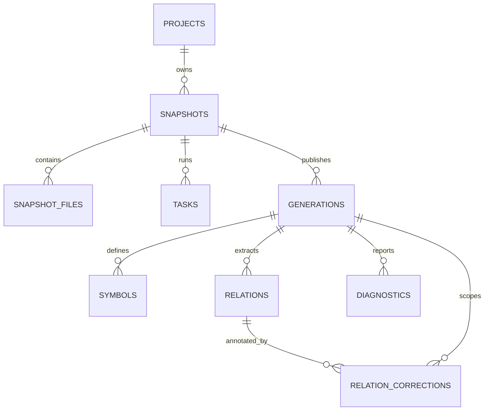
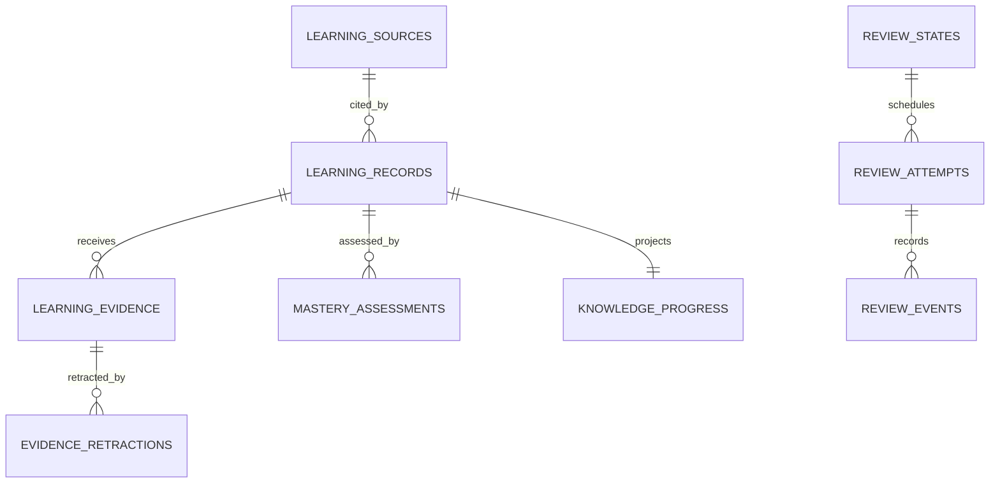
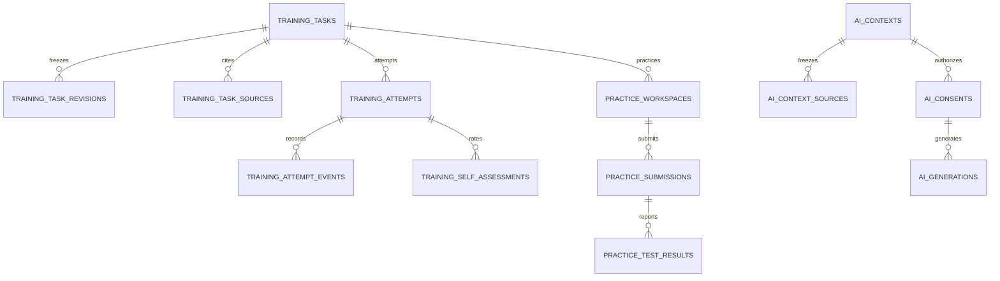

# CodeAtlas 领域模型

日期 2026-11-15。本文是领域表与不变量的导航，不是 DDL 权威来源；以 `src/main/resources/db/migration` 的 V1～V8 迁移为准。H2 用于测试，MySQL 8 用于真实验收。

## 1. 项目、快照与索引

- `projects`：导入来源；`source_type` 为 `LOCAL`／`GITHUB`，`path_hash` 用于同来源去重。
- `snapshots`：不可变源码快照；保存清单摘要、来源类型、Git 状态与解析后的 commit；发布指针指向当前代次。
- `snapshot_files`：快照内的路径、大小与 SHA-256；`.git`、密钥和构建产物不进入快照。
- `tasks`：IMPORT／INDEX 任务，单工作线程执行；包含 `source_type`、`source_ref`、状态、进度与稳定错误码；同一数据目录由 `instance.lock` 保证单实例。
- `generations`：一次索引代次；旧代次继续可查；`published=TRUE` 的代次是默认查询目标。
- `symbols`、`relations`、`diagnostics`：分析器投影，绑定代次；关系带 `kind`、`status`、`reason`、范围、resolver 与可选 `target_id`。
- `relation_corrections`：追加式用户修正，绑定快照、已发布代次与原始关系；不改写 `relations`、证据状态或图边聚合。

## 2. 学习、复习与掌握证据

- `learning_sources`：从快照/符号冻结的源码证据；引用校验以它为准。
- `learning_records`：解释、知识、文档、卡片等学习记录的版本化内容；知识记录有 revision。
- `review_states`／`review_attempts`／`review_events`：FSRS 状态、复习尝试与追加事件；评分事件不覆盖历史。
- `learning_evidence`：追加式证据事实，来源包括复习评分、训练结果、训练自评、个人复盘、实践提交与实践测试报告；`evidence_retractions` 单独撤回。
- `mastery_assessments`：按知识 revision 保存的评估快照；`EVIDENCE_V3` 综合自报复习、无帮助正确尝试与不同提交的用户报告通过实践测试（同一提交多份报告只计一次）。
- `knowledge_progress`：当前知识的评估投影；知识 revision 变化后重算，旧版本证据保留可查。

## 3. 训练、实践与 AI

- `training_tasks`／`training_task_revisions`／`training_task_sources`：任务定义、冻结版本与来源；修改任务后旧 attempt 仍按旧 revision 解释。
- `training_attempts`／`training_attempt_events`／`training_self_assessments`：理解题回答、逐题事件与自评；规则判分与帮助标记不被 AI 覆盖。
- `practice_workspaces`：从任务快照复制的独立练习目录；关闭或提交不改变原快照。
- `practice_submissions`：不可变提交，保存内容摘要、清单与差异预览。
- `practice_test_results`：用户外部测试报告，`source=USER_REPORTED`；PASSED/FAILED 可作证据，ERROR/TIMEOUT 不计能力。
- `ai_contexts`／`ai_context_sources`：外发前的冻结上下文与来源；有摘要、模型指纹与过期时间。
- `ai_consents`／`ai_generations`：显式 ALLOW／DENY 与幂等生成；拒绝不调用模型。
- `mutation_requests`：幂等写入记录；同一键同内容返回原结果，同键异内容冲突。

## 4. 引导

`guide_runs` 保存六步引导状态，`guide_events` 保存步骤事件，`guide_ai_requests` 保存显式授权的候选建议。步骤状态独立于能力证据；引导建议不会自动写掌握状态。

## 5. 跨领域不变量

1. 已发布快照、代次、分析投影、练习提交和学习证据不原地改写；状态变化通过新代次、新事件、新证据或追加修正表达。
2. 所有对外查询默认使用已发布代次；历史代次必须显式指定且继续可读。
3. 关系修正、证据撤回和复习事件都是追加记录，原始事实保留。
4. AI 只能读取已冻结上下文并经显式授权生成；AI 结果标记 `AI_ASSISTED`，不改规则判分、证据、掌握状态或图边。
5. 源码外发、项目执行和 Git 克隆均不在浏览/索引路径中隐式发生；外部测试报告不等于系统执行。
6. 迁移以 Flyway 为准；新增列优先可空或带默认值，保证旧数据可读和回退。
