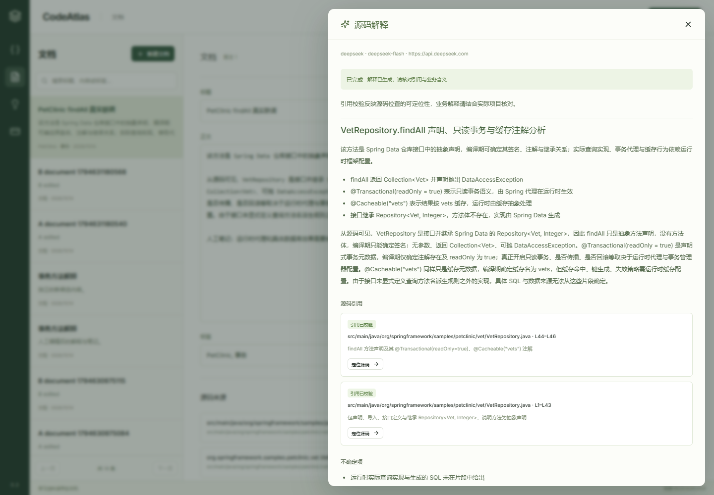
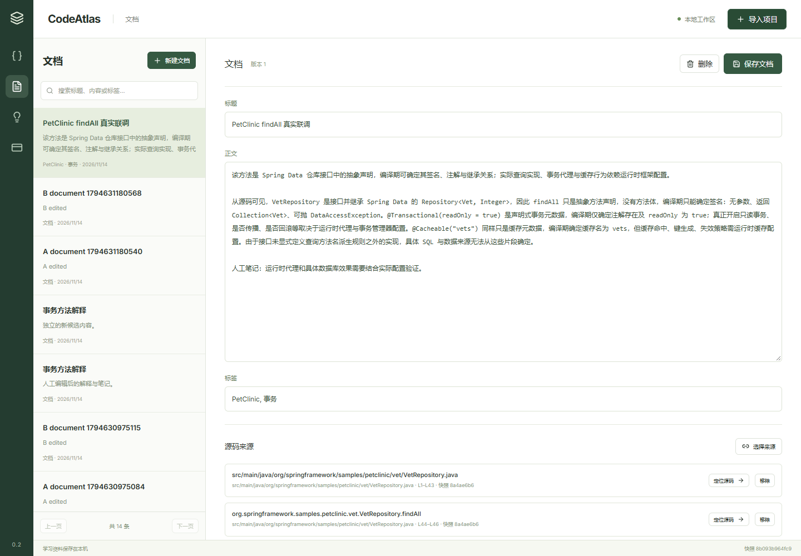

# CodeAtlas V0.2 验收记录

日期为 2026-11-14，状态为已交付。范围依据 scope-v0.2.md 和已批准的 2026-11-14-v0.2-design.md。源码分别位于 D:/CodeAtlas/CodeAtlas后端、CodeAtlas前端、CodeAtlasAI。

## 交付

包含固定快照来源、预览授权、独立 Python 模型适配、结构化解释、引用校验、追问、生成恢复，以及文档、跨项目知识、卡片的创建、搜索、查看、编辑和软删除。Java API 和前端随 codeatlas-0.2.0.jar 交付，Python 独立运行。运行脚本位于 D:/CodeAtlas/scripts/start-local.ps1。

JAR 大小为 32874985 字节，SHA-256 为 `d6e12da790d85969a330b18b4aecb7da26cf873d8cdfe6cb6c66762c1394d7f3`。前端生产资源已打入 JAR。

## 实际验证

| 验证 | 结果 | 证据 |
|---|---|---|
| 后端 H2 全部回归 | 23 项通过，零失败/错误 | target/v02-package.log，Maven verify 退出0 |
| 后端 MySQL 8.0.43 全部回归 | 23 项通过，零失败/错误 | target/v02-mysql-final.log，Surefire XML |
| Python AI 服务 | 6 项通过 | CodeAtlasAI/test-v02.log |
| TypeScript 和 Vite 生产构建 | 通过 | CodeAtlas前端/target-build-v02.log |
| Vite 浏览器全流程 | 5 项通过 | CodeAtlas前端/target-browser-final.log |
| JAR 8080 生产界面 | 5 项通过 | CodeAtlas前端/target-browser-production.log |
| V1 已有 MySQL 库升级 | 从1增量迁移到2，旧 PetClinic 快照/245个符号可用 | codeatlas_browser 与生产启动日志 |
| Java 重启 | 文档、知识、卡片正文/笔记/revision/来源身份及原生成结果全部一致 | target/v02-restart-check.json |
| AI 离线 | 已存资料可读、手工文档可保存 | target/v02-restart-check.json |
| 中断恢复 | 独立 RUNNING 任务种子重启后 FAILED/PROCESS_INTERRUPTED | v02-recovery-generation，target/v02-recovery-runtime.log |

使用本次独立 MySQL 3307 实例与 codeatlas_v02_test、codeatlas_v02_learning、codeatlas_v02_ai 三个测试库。浏览器使用专用 codeatlas_browser 验收库。数据库迁移兼容性同时覆盖空库和已有 V1 数据。用户 MySQL80 服务由用户独立管理。

启动脚本已实际启动 Java 与 Python，自动生成的共享内部令牌通过 /api/ai/provider 验证，Java /api/health 返回0.2.0。

## 覆盖的行为

后端覆盖授权拒绝、过期和供应商配置变化时零生成请求，重复请求幂等，伪造路径/越界引用标记无效，排队取消、发送前取消、迟到结果丢弃，服务错误后人工内容保留。Python 覆盖空内容、JSON/结构错误、鉴权失败、限额、超时和超大响应，配置只读取白名单。恶意源码注释的协议测试确认其保持在 user 数据中，只有一次预期模型请求，未附加工具权限。

学习资料覆盖跨项目来源、revision 冲突、重复创建冲突、无效来源原子回滚、实际分块请求体限额、知识删除后独立卡片继续编辑，以及 AI 资料移除来源后原生成引用仍可查。

浏览器覆盖两项目关联、历史快照跳转、拒绝发送的调用数为0、授权生成、引用状态、刷新后继续追问、保存与编辑文档、提炼知识、创建卡片、同类页面恢复 AI 后保存新候选、原文档人工内容保留，以及回退后迟到保存响应的实体隔离。原 V0.1 导入、重载搜索、关系定位与迟到分页回归通过。

## 真实 DeepSeek 联调

用户明确授权读取参考配置凭据，查询模型并使用公开 PetClinic 小范围联调。模型列表实际返回 deepseek-flash 与 deepseek-v4-pro，默认选用 deepseek-flash。此次执行一次生成，JSON 模式、关闭 thinking、temperature=0、max_tokens=4096。

- 官方公开源码固定 commit 为 `500158f732419217507c7656904b8e6aa1bcc0d6`。
- 来源仅为 `src/main/java/org/springframework/samples/petclinic/vet/VetRepository.java` 第44–46行及第1–43行文件头。
- 完整预览为 3147 字符、3203 UTF-8 字节。
- 供应商为 DeepSeek，模型 deepseek-flash，地址 https://api.deepseek.com。
- 生成至三类资料保存耗时 5.27 秒。
- 用量为 1226 输入 tokens、562 输出 tokens，共 1788 tokens。
- 结果状态 SUCCEEDED，两条引用均 VERIFIED，已保存文档、知识、卡片并完成重启核对。
- taskId 为 `4d39088a-7d9c-41f1-bde8-afce3b12f0d2`，snapshotId 为 `8a4ae6b6-738b-463f-92e9-04f9e3669041`，索引代次为 `caa5cd0d-4eeb-44bd-8c55-bf3723af7a01`。

真实结果识别了接口抽象方法、只读事务注解、缓存注解及运行时配置不确定性。原始固定源码未被修改。凭据通过 CODEATLAS_LLM_ENV_FILE 引用，源码、示例、测试和报告未复制模型密钥。验收脚本 scripts/acceptance_learning.py 需要显式 --generate-public-petclinic 参数，运行会产生真实模型费用。

官方接口依据包括 [JSON mode](https://api-docs.deepseek.com/guides/json_mode/)、[Thinking mode](https://api-docs.deepseek.com/guides/thinking_mode/) 和 [模型说明](https://api-docs.deepseek.com/quick_start/pricing/)。

## 独立审阅与修复

独立审阅发现三个重要问题。发送前取消缺少状态记忆，迟到保存响应可能进入另一资料编辑器，删除知识后卡片保存失败。新增回归分别观察到失败，再完成修复并通过完整 H2、MySQL 与浏览器回归。审阅另指出 AI 来源移除后重现、同类页面恢复 AI 保存后选择未同步，已一并修复并覆盖回归。

## 实施决策与限制

- 默认模型由账号实际返回值确定为 deepseek-flash，模型可配置，后续账号可用列表变化需调整本机配置。
- 学习实体统一使用 learning_records 和 learning_sources，通过 kind 验证字段。未来拆表需增量迁移。
- 当前构建使用 E:/jdk24，目标为 Java21，短 ASCII 临时目录解决本机 JDK 管道错误。运行脚本提供该进程配置。
- 源码上下文采用所选声明、文件头或人工关联来源。一次 AI 解释要求同快照与代次，知识资料支持跨项目关联。项目/流程说明覆盖范围由预览片段决定。
- 引用校验代表固定源码位置可定位，解释事实仍需要人工核对。外发后的计算可能继续，取消会丢弃迟到结果。
- Monaco 生产主包约3.56 MB，构建出现 chunk 大小提示。浏览器生产流程已通过，首次加载仍受该体积影响。
- 本机单用户部署，数据库和快照目录需配套备份。真实联调使用专用验收库，用户正式数据库连接仍由本机环境变量提供。

## 界面

验收结束后，本次 Java、Python、Vite、模拟提供商和3307独立 MySQL 测试实例已停止。正式使用时配置自己的数据库连接，并按 README 启动。
