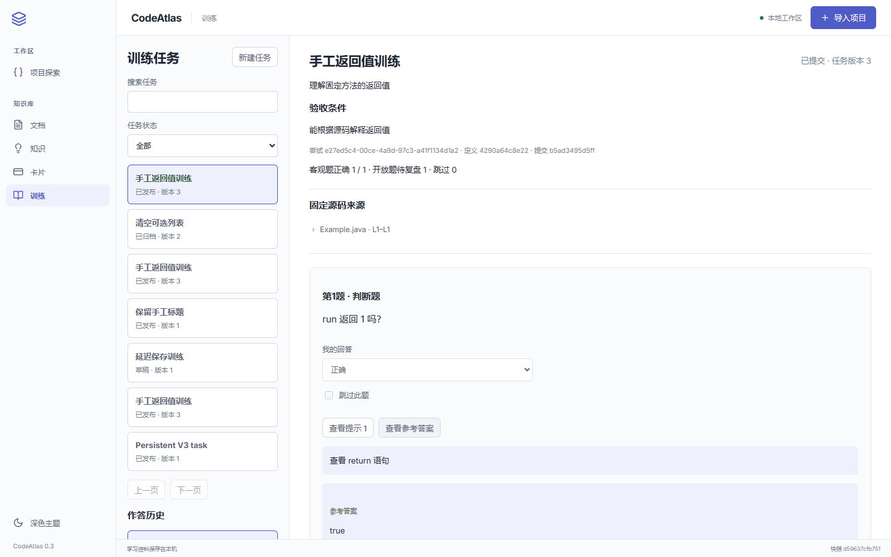
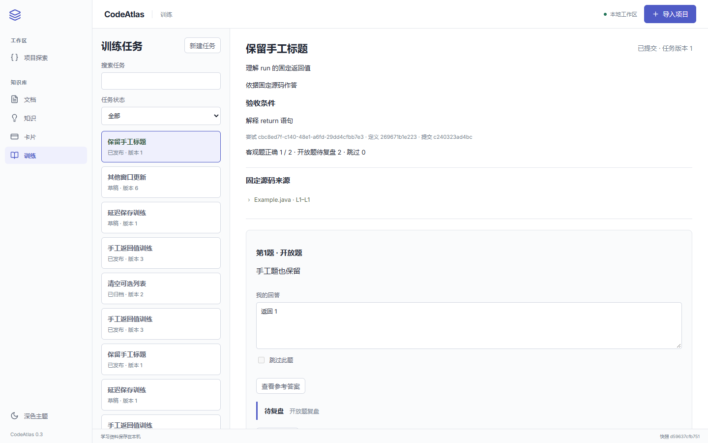

# V0.3 训练首批验收

日期 2026-11-14。依据已批准的 V0.3 训练设计，交付版本0.3.0，范围为训练任务管理与源码理解题。

## 已实现

- 从源码方法建立任务，手工多题编辑、固定来源、目标、约束、验收条件和标签。
- 代码阅读、调用链理解、错误判断，支持单选、判断和开放题。
- 草稿、发布、编辑版本、搜索、归档和软删除，历史尝试绑定不可变版本与来源哈希。
- 保存回答、逐题跳过、整次跳过、提交和重新作答，提交幂等及 revision 冲突控制。
- 按需查看提示与参考答案，持久化查看事实，冻结提交前帮助标记。
- 客观题规则判分、开放题用户自评和个人复盘，历史恢复及结果摘要。
- AI 出题候选、人工编辑/追加、提交后的逐题 AI 辅助反馈。复用外发预览、拒绝/授权、预算、摘要、配置指纹、排队与取消机制。
- AI 引用校验、用途隔离与来源版本检查，反馈独立标记 AI_ASSISTED。
- 历史源码不可读时保留题目、回答与固定来源元数据，显示不可用状态。

## 验证记录

| 验证 | 当前结果 |
|---|---|
| Java H2 全量 | 35项通过，1项MySQL专用锁测试跳过 |
| Java MySQL8 全量 | 36项通过，独立3307四库 |
| Python/FastAPI | 8项通过 |
| TypeScript 与生产构建 | 通过 |
| 生产静态浏览器 | 11项通过 |
| 最终 JAR + MySQL 浏览器 | 12项通过，包含审阅回归 |
| 主题与窄屏模拟UI | 1项通过 |
| V2→V3 增量迁移 | 旧文档/来源保留，V1/V2/V3 success=1 |
| V3 同库重启 | 任务版本、回答、结果、提示与提交摘要一致 |
| 独立代码审阅 | 完成，发现项已补RED→GREEN并通过全量回归 |

Java 测试涵盖来源/题目校验、草稿发布、旧版本绑定、归档删除、幂等冲突、终态保护、开放题自评、缺失源码降级、并发揭示与提交。AI 测试覆盖旧解释兼容、新用途结构、拒绝零外发、错误用途、伪造引用、请求题型不匹配、冻结回答反馈与原判分保护。

浏览器覆盖源码建题、保存与刷新、连续保存 revision、发布与作答、提示、规则判分、自评、参考答案、重新作答与跳过、迟到保存隔离、AI拒绝/授权/刷新候选/追加与逐题反馈。既有探索、文档、知识和卡片流程参与全量回归。

MySQL 并发测试曾复现默认 REPEATABLE READ 下帮助事件被旧快照遗漏，提交读取改用锁定当前读取后全量通过。整次跳过曾清空已有草稿，保留回答后回归通过。训练入口测试先观察缺少按钮的失败，再实现并通过。

## 产物与运行

JAR 位于 `D:/CodeAtlas/CodeAtlas后端/target/codeatlas-0.3.0.jar`。代码仍分别位于 CodeAtlas后端、CodeAtlas前端、CodeAtlasAI。启动脚本 scripts/start-local.ps1 已使用新 JAR 名称。Java 目标21，当前构建使用 E:/jdk24 与短临时目录。

分发包 application.yml 使用环境变量模板，本机源 YAML 保留用户配置。JAR 静态资源按本次 dist 收集，产物摘要见配套 evidence 目录。运行脚本可用外置 Spring Boot 配置或数据库环境变量。运行中的旧服务需要重启后加载本次代码。

契约位于 contracts/openapi.yaml 和 contracts/v0.3-training.md，决策位于 docs/adr/ADR-006-v0.3-training.md。

## 实施决策与验证边界

- 仓库缺少 Git 元数据，采用现有目录文件交付，保留实施前文件哈希基线和最终产物哈希。分支、Commit 与 Git 工作区状态无验证记录。
- 历史来源不可读时提供元数据降级。恢复源码需配套保存的快照目录，新增保存和 AI 预览继续核验来源。
- 未保存编辑内容采用 sessionStorage 会话草稿，关闭浏览器会话前需保存到服务器。
- AI 候选追加人工题，空白占位题自动剔除，超过十题整体拒绝追加。用户需要自行删减题目。
- 本轮 AI 使用本机固定响应上游和模拟传输，未新增向第三方发送源码。真实模型的题目语义与辅助反馈质量仍待人工验收。
- 前端 Monaco 主包约3.59MB，构建继续提示 chunk 大小。当前浏览器流程覆盖交互可用性，完整性能压力和首次加载性能仍待测量。
- 本批完成 V03-01/V03-02 的批准训练子范围。V03-03及之后的代码副本、修改题和执行验证属于后续开发。个人掌握记录已确认归属 V0.4。

## GitHub 参考

固定阅读 exercism/problem-specifications 的 hello-world canonical-data，借鉴稳定用例 UUID 和显式期望值，MIT，未新增依赖。许可与固定 commit 记录于 references-and-licenses.md。[固定参考源码](https://github.com/exercism/problem-specifications/blob/84a96854db1bda581317164d3e6ac6aa01723182/exercises/hello-world/canonical-data.json)

## 最终审阅修复

- 已保存任务与本地未保存草稿分离，归档后编辑读取新 revision。真实草稿冲突保留人工内容，提供“放弃本地修改并加载最新版本”。覆盖发布、归档、再编辑保存、其他窗口更新及显式恢复。
- 可选标签和提示在提交前过滤空元素，清空字段和提示尾部换行均能保存。
- AI 历史恢复期间显示恢复状态，完成前关闭新预览入口。延迟旧生成请求的浏览器回归通过。
- MySQL 开始作答等待并发编辑时，版本及返回定义采用当前读取。锁屏障测试先复现 ApiException，再修复通过。该专用回归使用测试账号的 SHOW FULL PROCESSLIST 观察等待顺序。
- 开放题前端输入上限与服务端统一为4000字符。将该审阅次要项提升为需修复项，避免页面允许输入无法持久化的回答，maxlength 回归先失败后通过。

本机单用户作者编辑入口提供完整答案，符合批准的自学流程。帮助记录描述本次尝试通过应用入口进行的查看操作。当前没有延期的审阅发现项。

## 证据与产物摘要

配套证据位于 docs/reports/evidence/v03-training-2026-11-14。包含MySQL/H2套件计数、最终打包日志、最终JAR浏览器日志、Python回归、迁移重启JSON、审阅复现和修复日志及界面截图。H2最终验证以 v03-final-package.log 和 v03-h2-summary.json 为准。

最终 JAR SHA-256 `7c67ee48deffd4e17131ddfeec350bf2f5cc91886062bff8d90e60d4b4b46a13`，大小 32907856 字节。包内配置已与环境变量模板逐字节核对，静态资源与本次 dist/index.html 一致，ZIP完整性校验通过。

验收结束后，本轮18080/18083 Java、18001 FastAPI、8002固定响应上游和3307专用MySQL测试进程均已关闭。正式使用时重启本机应用服务，数据库连接由用户本机配置提供。
