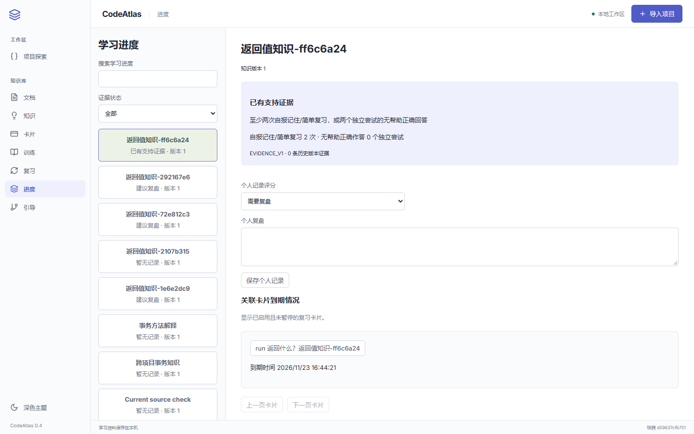
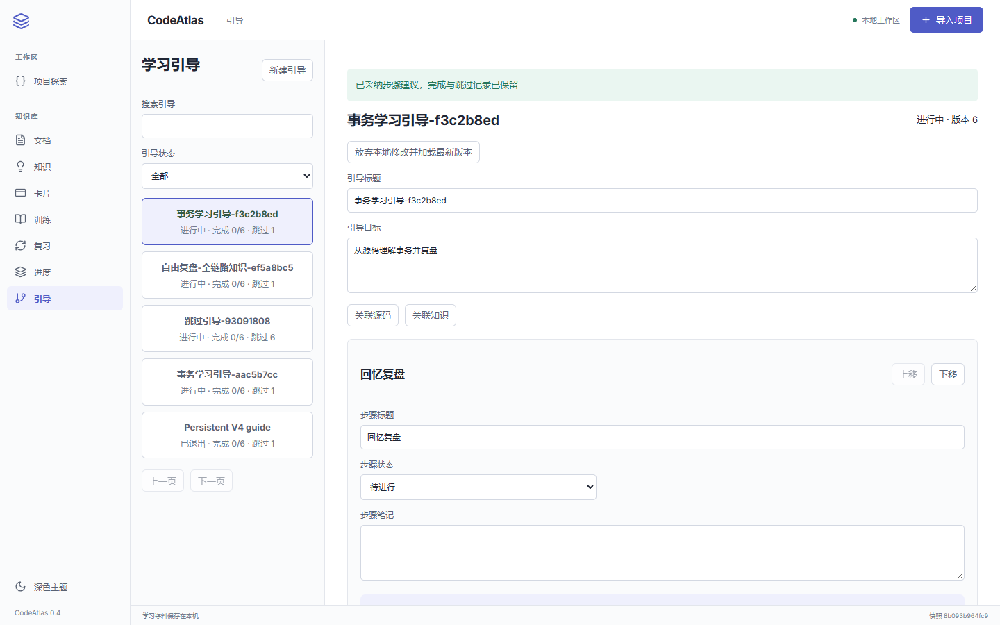

# V0.4 验收记录

日期 2026-11-15。依据用户批准的 V0.4 设计，范围为 V04-01 至 V04-05，交付版本 0.4.0。

## 功能

- 卡片主动加入复习，到期队列、知识和标签筛选，暂停、恢复和采用新版重新学习。
- 回忆草稿、揭示参考答案、四档用户自评、复盘和跳过，FSRS 调度及逐次不可变历史。
- 固定算法、配置指纹、UTC 毫秒时间、内容摘要、独立轮次、幂等重试与并发冲突保护。
- 独立学习证据、判断历史和当前掌握投影，区分自报与规则判分，支持关联、撤回和知识版本隔离。
- 理解题错题入口、原始作答与历史来源跳转，个人评分和复盘。
- 可选六步学习引导，调整顺序、标题、笔记，完成、跳过、暂停、退出恢复和重新打开。
- 经预览和逐次授权的 AI 引导候选，精确六步校验、显式采纳、版本冲突保护和原状态保留。
- 源码、解释、知识卡片、理解题、复习、证据与引导贯通，历史引用继续指向固定快照。

## 验证

| 验证 | 结果 |
|---|---|
| Java MySQL8 全量 | 57项通过，独立3307专库 |
| Java H2 全量与打包 | 53项通过，4项MySQL专用测试跳过，构建成功 |
| Python/FastAPI | 10项通过 |
| TypeScript / Vite生产构建 | 通过 |
| 最终JAR + MySQL浏览器全流程 | 23项通过 |
| 深浅主题与窄屏 | 既有UI模拟1项通过，新增三页6组390px布局检查通过 |
| V3→V4迁移与同库重启 | 通过，四次Flyway迁移success=1 |
| 独立实现审阅 | 完成，三项Important及一项Minor均已修复并回归 |
| F05 到期字段与中文取证（2026-11-16） | 通过：dueAtMs 为 epoch 毫秒，ISO 为 UTC，重启前后 state 字节一致；中文 API→MySQL→JSON→mysqldump→恢复库逐字节一致；迁移摘要乱码为导出侧问题（`docs/reports/followup-F05-2026-11-16.md`） |

并发回归覆盖相同幂等键评分等待、不同尝试竞争、MySQL锁等待后的当前读取、知识投影锁等待和事务回滚。浏览器覆盖旧功能、新复习与学习证据、引导授权恢复、超过20条历史身份跳转、完整学习闭环，以及审阅新增的重复个人记录、失败请求原键重试、多题定位和知识关联卡片到期入口。

V3→V4 专用数据库升级与重启对比保留旧文档、卡片与训练提交，并恢复两次复习、调度时间和配置、证据判断及退出后的引导步骤。

新复习、进度、引导页面在 390px 深浅主题下均无横向溢出，截图已人工查看。已有主题和窄屏模拟 UI 测试通过。

## 产物与使用

代码分别位于 `D:/CodeAtlas/CodeAtlas后端`、`D:/CodeAtlas/CodeAtlas前端` 和 `D:/CodeAtlas/CodeAtlasAI`。分发包为 `D:/CodeAtlas/CodeAtlas后端/target/codeatlas-0.4.0.jar`，启动脚本已使用新包名。Java 目标21，本次构建使用本机 JDK24。

源码 application.yml 保留本机配置，分发包内配置采用环境变量模板。快照数据目录需要配套保留。契约见 contracts/openapi.yaml 和 contracts/v0.4-review-evidence-guides.md，调度决策见 docs/adr/ADR-004-v0.4-review-scheduler.md。

## 实施决策与验证边界

- 缺少 Git 元数据，采用现有目录文件交付，保留实施前哈希基线和最终产物摘要。回退依赖保存的文件和数据备份。
- 按批准设计采用 Java FSRS 1.0.0 固定配置和 EVIDENCE_V1 规则，评分为用户自报，判断显示来源及依据。
- 复用 mutation_requests，新增可空 response_payload 保存新功能的精确幂等响应，旧插入语句继续兼容。回退时保留该增量列及历史表。
- 无源码来源的 AI 预览用于学习引导，已有解释和训练继续要求固定来源。上下文协议升级至3。
- 未保存的页面编辑采用 sessionStorage，会话结束前需保存到服务器。
- 本轮 AI 验收使用本机固定响应服务，未新增向第三方发送源码。真实模型的引导语义与辅助建议质量仍待人工验收。
- 前端主包约3.63MB，构建提示 chunk 大小。实际首次加载性能和完整压力测试仍待测量。
- V03-03及之后的代码副本、修改题和执行验证属于后续范围，引导中的编码和验证步骤可记录外部学习说明。

## 审阅与证据

独立审阅发现并修复三个Important问题。并发同键命令在领域操作前事务性占用请求键，成功响应原样恢复。引导预览在同一事务内按固定顺序锁定知识后冻结正文与学习摘要。个人记录成功保存后释放本次请求键，未确认成功的重试继续使用原键。

同时修复多题原始作答的精确定位，恢复题目高亮、聚焦、刷新与前进后退。按批准需求补齐知识关联卡片的到期时间及分页入口，复用已有复习接口。所有新增回归均先观察失败，再通过修复验证。本次没有延期审阅项。

最终测试日志、产物摘要、迁移重启结果、失败复现和修复日志及截图已归档到 docs/reports/evidence/v04-2026-11-15。源码哈希基线位于 D:/CodeAtlas/.runtime/v04-baseline.json。Java-FSRS上游MIT、固定commit及六项隔离验证见v0.4-fsrs-poc.md及配套证据。

最终 JAR SHA-256 `833d41fbcf736fef71da9f156dc488c400c7362b89027d766db9c2812d0bb849`，大小 32991043 字节。包内环境变量配置、当前前端静态资源、MIT许可和ZIP完整性均已核对。V0.3基线JAR摘要仍为 `7c67ee48deffd4e17131ddfeec350bf2f5cc91886062bff8d90e60d4b4b46a13`。

验收完成后，已按实时命令身份关闭本轮 Java18083、AI18001、固定响应服务8002及专用MySQL3307，核验18080/18083/18001/8002/3307均已无监听。正式使用需重启本机后端及AI服务，读取用户自己的数据库配置。

