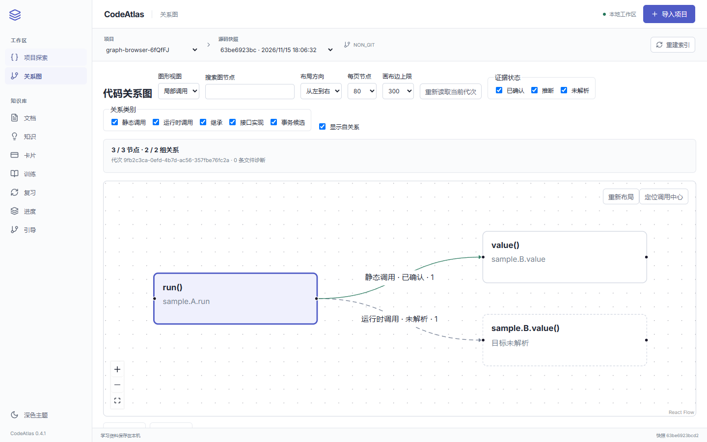
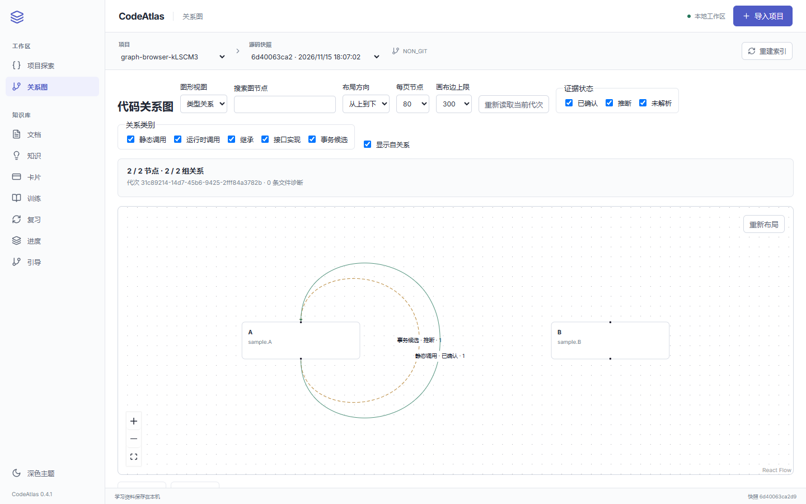

# V0.4.1 交互关系图验收

日期2026-11-15，依据用户批准的交互关系图设计，交付版本0.4.1。

## 已实现范围

包依赖、类型关系和一跳调用视图，状态／类别过滤、搜索、成员下钻、原始证据分页、固定快照源码跳转、URL与会话视口恢复。React Flow实际作为前端依赖，Dagre在Worker计算布局。未知目标、归属歧义、部分索引和截断数量在页面可见。类关系基于已有静态符号，架构视图按Java包聚合。

## 最终验证

| 验证 | 结果 |
|---|---|
| Java H2全量／最终打包 | 67项，63通过，4项MySQL专用跳过 |
| Java MySQL8全量 | 67项通过，独立3307九个测试库 |
| Python/FastAPI兼容 | 10项通过 |
| 纯布局／自环几何 | 5项通过 |
| TypeScript／Vite | 生产构建成功 |
| 最终JAR + MySQL浏览器 | 30项通过，包含7项图谱流程 |
| 既有主题／窄屏模拟 | 1项通过 |
| V4→V6升级／同库重启 | 10个旧资源对照通过，源码及旧代次图恢复 |
| 独立实现审阅 | 1项Important、1项Minor均修复并回归 |

图谱浏览器覆盖包→类型→源码→后退、成员→局部调用→原始证据行号、刷新与旧代次、迟到查询／Worker、窄屏键盘、切换项目清理范围、重建后主动采用新版、首次索引自动刷新，以及两种方向下并行自关系的真实SVG点击。既有探索、知识、训练、复习、证据、引导同时回归。

布局测试覆盖循环、自环、同端点多状态边、输入隔离和确定性，最终50／500／1000节点布局约14／107／314毫秒。这是本机纯布局样本，完整大项目加载与压力尚未测量。

## GitHub复用

- @xyflow/react12.12.1，commit1bc405cd113618c17fd181b931a9fe573bec9fee，用于交互节点、边、缩放、拖拽、主题和键盘入口。
- @dagrejs/dagre3.1.3，commita73acbfebe6fda008e1a3d80f3738170699c3d6b，graphlib4.0.6，用于有向布局。原候选2.0.0发布包缺少类型声明，按批准设计改用同路线3.1.3。
- Understand Anything的GraphBuilder，commit5cc4aad9b8b43596dfedaee00755a7223825fe9b，参考节点／边分离、容器和去重。产品适配采用既有CodeAtlas符号UUID、snapshot／generation和证据状态。

22项库及依赖的实际许可文件已收集到META-INF/third-party/graph，完整清单随验收证据归档。固定引用见ADR-003和references-and-licenses.md。

## 实施决策与边界

首版画布默认80、最多200节点，默认300、最多1000边，列表与分页可继续探索。包／类型搜索展示命中节点间的关系，CALL始终保留中心并对邻居分页。不同代次和状态保留独立身份。

图功能本身无需新增迁移。开发前基线已经包含V5证据排序和V6练习副本，运行包保留这些内容并进行兼容回归。AI服务保持既有0.4.0／协议3，新增图查询使用本机索引。本轮既有AI回归使用本机固定响应服务。

当前目录缺少Git元数据，采用文件哈希和运行包交付，回退依赖保存的文件与数据库／快照备份。分发配置使用环境变量模板，源码本机配置保留。流程图、时序图、完整UML属性展示和archify导出按已选后续范围推进。

## 审阅修复与恢复

首次索引完成时，App任务revision传入图谱查询，空图会刷新并固定实际发布代次，重建已有图继续保留原代次。并行自环按稳定序号分配半径与标签位置，纵向路径从底部向外绕行再进入顶部，布局为环与标签留出空间，适应画布包含环范围。

原测试曾选择随机排序的第一条关系却假设其为已确认静态调用，已改为明确选择对应状态与类别。没有延期审阅发现项。

专用升级库由V4应用开发前已有的V5／V6迁移，六次Flyway记录均成功。0.4.0升级前捕获文档、知识、卡片、训练尝试、复习状态／两次尝试、进度、引导和固定源码等10个资源。0.4.1逐字段核对原字段并允许增量字段，再重建索引并验证旧图，重启后全部恢复。

最终日志、失败复现、修复回归、依赖许可清单、迁移／重启JSON和截图在docs/reports/evidence/v041-graphs-2026-11-15。哈希基线保留于D:/CodeAtlas/.runtime/graph-baseline.json。

## 产物

JAR为D:/CodeAtlas/CodeAtlas后端/target/codeatlas-0.4.1.jar，SHA-256 `af2177532d31cbfded36d62db0c194255ab1713fd6937f6b5a23253f41738874`，大小33147211字节。逐文件核对当前dist、环境变量配置和22份图谱依赖许可，ZIP完整性通过。启动脚本scripts/start-local.ps1已使用新包名。Java目标21，本次构建使用JDK24。

图工作区按需加载约215kB，Worker约49kB，主包约3.64MB并保留构建体积提示。纯布局测量与1类型小样本的HTTP测量随证据保存，实际大项目的整体加载与压力测试尚未完成。

最终局部调用、并行自关系和深色窄屏截图已人工查看。验收后已按实时命令身份关闭本次Java18080／18083、AI18001、固定响应服务8002和专用MySQL3307，端口核验均无监听。正式使用请重启本机后端及AI服务，数据库连接由本机配置提供。
